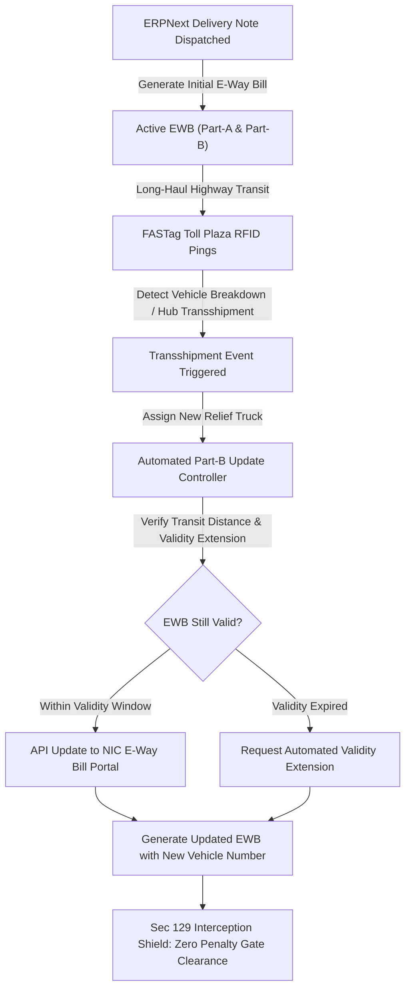

# Frappe E-Way Bill Multi-Vehicle Transshipment & FASTag Toll Engine

[](https://frappeframework.com/)
[]()
[]()
[]()
[](LICENSE)

## 📌 Executive Overview & Real-World Client Problem

Under Indian Goods and Services Tax transport regulations:
1. Every consignment over ₹50,000 moving inter-state requires an active **E-Way Bill (EWB)**.
2. **Vehicle Breakdown & Transshipment Risk:** During long-haul transport, vehicle breakdowns or hub-and-spoke multi-vehicle transshipments require updating **Part-B (Vehicle Number)** before the goods move onto the new truck.
3. **Section 129 Vehicle Detention Penalties:** If state GST flying squads intercept a truck whose physical vehicle number does not match Part-B, authorities impound the vehicle and impose a punitive **200% penalty on tax payable**.

This Frappe application provides an automated fleet transshipment engine that updates Part-B in real time and reconciles vehicle progress via RFID FASTag toll plaza webhooks.

---

## 🏛️ System Architecture Flow



---

## 🚀 Key Engineering Capabilities

- **Instant Multi-Vehicle Part-B Updates:** Programmatically switches transport vehicles during hub-and-spoke transfers.
- **Section 129 Penalty Protection:** Enforces digital locks ensuring no cargo vehicle departs transshipment yards without updated EWB documents.
- **Validity Distance Extension:** Calculates remaining distance and triggers validity extensions when vehicles face highway breakdowns.
- **FASTag Toll Geo-Verification:** Correlates toll plaza transaction timestamps with driver logbook entries.

---

## 📂 Frappe DocType Schema & Data Structure

```text
ewaybill_transshipment/
├── ewaybill_transshipment_core/
│   ├── doctype/
│   │   ├── eway_bill_transit/
│   │   │   ├── eway_bill_transit.json
│   │   │   ├── eway_bill_transit.py
│   │   │   └── eway_bill_transit.js
│   │   └── transshipment_event/
│   │       └── transshipment_event.json
│   └── workspace/
│       └── ewaybill_transshipment_workspace/
│           └── ewaybill_transshipment_workspace.json
```

---

## ⚡ Frappe Hooks & Whitelisted APIs

- **REST Endpoint:** `POST /api/method/ewaybill_transshipment.api.execute_multimodal_transshipment`
- **Whitelisted Method:** `@frappe.whitelist() def register_eway_bill(ewb_number, from_pincode, to_pincode, vehicle_number)`
- **Hooks Event:** `on_submit` of `Delivery Note` triggers automated E-Way Bill creation.

---

## 🛠️ Installation & Bench Setup

```bash
bench get-app https://github.com/shyampandey1104/frappe-ewaybill-multimodal-transshipment
bench --site erp.yourdomain.com install-app ewaybill_transshipment
bench --site erp.yourdomain.com migrate
python3 -m unittest discover tests
```

---

## 📄 License
MIT License. Engineered for Logistics Transporters, 3PL Fleet Carriers, and Manufacturing Consignors.
